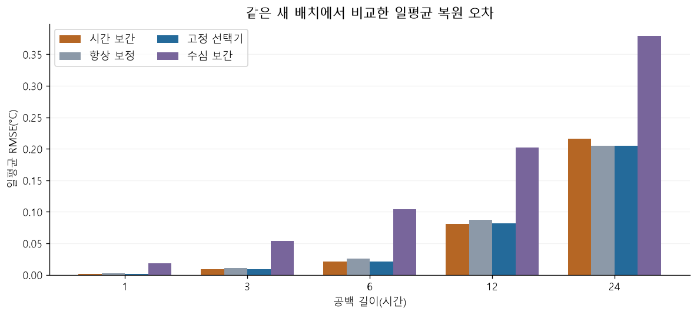
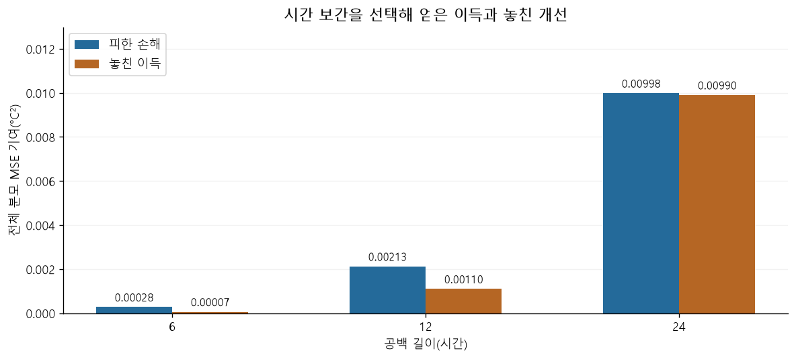

# 최종 고정 시험의 저장된 그림

원래 실행된 노트북의 PNG 출력을 그대로 추출했습니다. 그림을 만들려고 새 분석이나 보정식 변경을 수행하지 않았습니다. 표의 정확한 값은 [원래 집계](evidence/selector-harm-avoidance-20261022/overall.csv)에 있습니다.

## 일평균 복원 오차

같은 Rottnest 새 배치의 가상 공백에서 비교한 결과입니다. 세 센서가 같은 수직선에 놓인 자료가 아니며, 가운데 센서와 위·아래 계류 사이 거리는 약 3.17km입니다. 시간 보간과 선택기의 작은 차이는 이 막대만으로 읽기 어렵습니다. 상세 차이와 불확실성은 [결론](CONCLUSIONS.md)을 함께 보세요.

## 피한 손해와 놓친 이득

두 값은 같은 전체 평가 분모의 **MSE 기여량(℃²)**입니다. RMSE 차이나 해양 안전 피해량이 아닙니다. 24시간 공백에서는 두 막대가 거의 같으므로, 높은 손해 회피율만으로 유용성이 입증됐다고 해석할 수 없습니다. 문맥 부족 fallback과 관측 비교에 따른 선택도 분리해야 합니다.

그림 원본은 링크를 열면 확대할 수 있습니다. 휴대전화 폭에서는 전체 그림의 글자가 작아집니다. 원 노트북의 폭넓은 표는 가로 스크롤이 필요하며, 공개 결론 문서는 핵심값을 다시 설명합니다.
